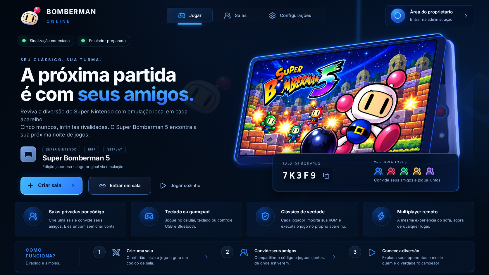
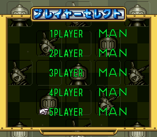
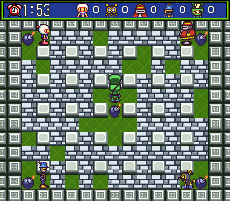

<div align="center">
  
  <h1>Bomberman Online</h1>
  <p>Super Bomberman 5, sua turma e até cinco jogadores no computador ou celular.</p>
  <p>
    <a href="https://bomberman-online.vercel.app"><strong>Jogar agora</strong></a> ·
    <a href="#como-jogar-com-os-amigos">Como jogar</a> ·
    <a href="#baixar-e-guardar-o-jogo">Baixar o jogo</a> ·
    <a href="#rodar-no-seu-computador">Instalar o projeto</a>
  </p>
</div>



Este repositório guarda o código do site, as artes, os controles, os testes, os cores do emulador modificados e a cópia do jogo fornecida pelo proprietário. O multiplayer executa o **jogo original de Super Nintendo em cada navegador**, com imagem e áudio locais. WebRTC sincroniza os comandos e o estado da partida.

**Site publicado:** https://bomberman-online.vercel.app

**Repositório:** https://github.com/MartnsDev/bomberman-multiplayer

## Conteúdo

- [Recursos](#recursos)
- [Fotos do projeto](#fotos-do-projeto)
- [Baixar e guardar o jogo](#baixar-e-guardar-o-jogo)
- [Como jogar com os amigos](#como-jogar-com-os-amigos)
- [Controles](#controles)
- [Instalar no celular e reutilizar o jogo](#instalar-no-celular-e-reutilizar-o-jogo)
- [Desconexão, foco e retorno](#desconexão-foco-e-retorno)
- [Salvar e restaurar](#salvar-e-restaurar)
- [Rodar no seu computador](#rodar-no-seu-computador)
- [Administração e senha](#administração-e-senha)
- [Deploy na Vercel](#deploy-na-vercel)
- [Testes](#testes)
- [Soluções para problemas comuns](#soluções-para-problemas-comuns)
- [Estrutura e documentação](#estrutura-e-documentação)
- [Créditos e licenças](#créditos-e-licenças)

## Recursos

- Salas privadas por código, para **até cinco pessoas**: anfitrião e quatro convidados.
- Perfis de Matheus, Gabi, Helo e Gu, além da opção de adicionar outras pessoas. Helo usa a inicial enquanto sua foto não é cadastrada.
- Interface responsiva, controles de toque, teclado e gamepad USB/Bluetooth compatível com o navegador.
- Direção e bomba simultâneas por multitoque; controles maiores e modo expandido no celular.
- Emulação SNES local com Multitap: cada participante controla sua própria posição.
- ROM instalada uma vez no navegador, em IndexedDB; pré-carregamento do emulador e imagens públicas.
- Transferência de coordenação, retorno ao estado atual e controle ausente neutro para manter os outros jogando.
- Atraso de entrada automático conforme rede e processamento; configuração manual também disponível.
- Save state local, restauração sincronizada e áudio/volume independentes por aparelho.
- Next.js, React e TypeScript; servidor Node local ou sinalização Vercel com Upstash Redis.

## Fotos do projeto

As imagens abaixo são capturas do site e do jogo executado pelo emulador.

| Tela inicial no celular                                                                                | Seleção dos cinco controles                                                                                                    |
| ------------------------------------------------------------------------------------------------------ | ------------------------------------------------------------------------------------------------------------------------------ |
|  |  |

<p align="center">
  
</p>

Mais capturas estão em [docs/design/screenshots](docs/design/screenshots).

## Baixar e guardar o jogo

A cópia fornecida pelo proprietário está em **[roms/super-bomberman-5.sfc](roms/super-bomberman-5.sfc)**, incluída neste backup a pedido dele.

**[Baixar o arquivo .sfc](https://github.com/MartnsDev/bomberman-multiplayer/raw/refs/heads/main/roms/super-bomberman-5.sfc)**

1. Baixe o arquivo `.sfc` no computador ou celular. Na página do arquivo no GitHub, o botão **Download raw file** também permite salvá-lo.
2. Abra o [site publicado](https://bomberman-online.vercel.app).
3. Abra **Instalar o jogo neste aparelho** e selecione o `.sfc`.
4. Aguarde a confirmação de instalação e a preparação do emulador.
5. Nas próximas visitas, use o mesmo navegador: a cópia instalada é reutilizada.

O arquivo tem **2.097.152 bytes (2 MiB)**. Seu SHA-256 está em [roms/SHA256SUMS](roms/SHA256SUMS). Todos os participantes precisam usar a mesma cópia para a sincronização funcionar.

Para guardar o projeto inteiro, use **Code → Download ZIP** no GitHub ou clone o repositório. A ROM fica na pasta `roms/`, fora de `public/`. Ela continua excluída do deploy da Vercel e do Docker; o endpoint `/api/rom` do site permanece autenticado.

## Como jogar com os amigos

### 1. Preparar os aparelhos

Cada pessoa abre o site e instala a ROM no próprio navegador. Aguarde **Emulador preparado** e a confirmação do jogo instalado. Em uma atualização de versão, todos devem sair da sala antiga, atualizar a página e criar uma sala nova.

### 2. Criar e compartilhar a sala

1. O proprietário entra em **Área do proprietário** com a senha administrativa.
2. Seleciona **Criar sala**, escolhe um perfil ou apelido e confirma.
3. Compartilha o convite ou código da sala com os amigos.
4. Os convidados usam **Entrar em sala**, escolhem o próprio perfil e informam o código. Eles não precisam de senha administrativa.
5. Depois que ROM, emulador e estado inicial estiverem prontos em todos os aparelhos, o proprietário seleciona **Iniciar partida**.

### 3. Configurar os jogadores no jogo original

O site organiza a conexão; os menus e regras continuam sendo os do Super Bomberman 5 original.

1. Pressione **Start** na tela inicial do jogo e entre no modo de batalha, **Battle Game**.
2. Na tela **PLAYER SELECT**, use o **Controle 1** para configurar as posições.
3. Use ↑/↓ para selecionar uma linha e ←/→ para mudar a opção:

| Opção   | Significado                        |
| ------- | ---------------------------------- |
| **MAN** | Pessoa controlando aquela posição  |
| **COM** | Jogador controlado pelo computador |
| **OFF** | Posição desativada                 |

Para três pessoas, deixe **1PLAYER, 2PLAYER e 3PLAYER em MAN**. Para cinco, deixe **as cinco posições em MAN**, como na captura acima. Posições sem participante podem ficar como COM ou OFF. Confira os números exibidos na lista de jogadores da sala.

Continue pelas opções da batalha. Cada jogador confirma seu personagem com **Start**, quando solicitado pelo jogo. Na arena, use o direcional para andar e **A / Bomba** para colocar bombas. Afaste-se antes da explosão, destrua blocos e recolha os itens da fase. A edição incluída é japonesa; os menus da ROM não foram traduzidos ou substituídos.

## Controles

### Teclado padrão

| Ação / botão SNES     | Tecla         |
| --------------------- | ------------- |
| Mover                 | Setas ↑ ↓ ← → |
| **A / colocar bomba** | **X**         |
| B                     | Z             |
| X                     | S             |
| Y                     | A             |
| Start / confirmar     | Enter         |
| Select                | Shift direito |
| L                     | Q             |
| R                     | W             |

A letra do botão SNES e a letra do teclado podem ser diferentes: **a tecla X aciona o botão A**, usado para a bomba. O menu **Configurações** permite remapear o teclado.

### Celular

- Use o direcional à esquerda e **Bomba** à direita.
- É possível segurar uma direção e tocar na bomba com outro dedo.
- **Start** e **Select** ficam nos controles da tela.
- Use o celular na horizontal e o modo expandido quando quiser mais espaço para a arena.
- **Ativar áudio** libera o som quando o navegador exige um toque do usuário.
- Para sair do modo expandido, use **Sair da tela cheia**.

### Controle físico

Conecte um gamepad USB ou Bluetooth ao aparelho e pressione um botão para o navegador reconhecê-lo. O suporte depende do gamepad e do navegador; o projeto usa a Gamepad API. Cada pessoa joga em seu próprio aparelho e controla a posição atribuída na sala.

## Instalar no celular e reutilizar o jogo

No menu do navegador, use **Adicionar à tela inicial** ou **Instalar aplicativo**, quando disponível. No Safari do iPhone/iPad, essa opção costuma aparecer no menu de compartilhamento. O site também oferece a instalação quando o navegador disponibiliza esse recurso.

A ROM fica no IndexedDB, e o emulador e imagens públicas usam cache com verificação de integridade. A primeira importação é necessária em cada navegador. Limpar os dados do site, usar outro navegador ou outro perfil pode exigir uma nova importação. O multiplayer continua precisando de internet; adicionar à tela inicial não transforma uma sala online em partida offline.

## Desconexão, foco e retorno

- **Um convidado sai, perde foco ou deixa de enviar comandos:** seu controle fica neutro e os demais continuam.
- **O convidado retorna:** recebe o estado atual individualmente, sem reiniciar a partida dos outros.
- **O coordenador vai para segundo plano:** cede a coordenação a outro aparelho preparado e disponível.
- **O coordenador para de avançar sem fechar a conexão:** após três segundos sem quadros, os demais podem solicitar uma eleição, validada pelo backend.
- **A troca de coordenador preserva os números dos controles:** coordenar a rede não transforma o Controle 2 em Controle 1.
- **Encerrar sala** é um comando intencional do proprietário e continua encerrando a sessão.

Uma mudança de coordenador pode exigir uma breve reconexão. Rede, capacidade do aparelho e restrições de NAT influenciam a resposta. O projeto não promete latência zero ou 60 FPS em qualquer dispositivo. O atraso automático começa em seis quadros e pode crescer até 24 para acomodar a rede e comandos que chegam fora do prazo; depois de estabilidade, ele pode diminuir novamente.

## Salvar e restaurar

**Salvar progresso** grava um save state no navegador do coordenador. **Restaurar para todos** distribui esse estado à sala. **Reiniciar jogo para todos** reinicia a sessão de forma sincronizada. Restauração e reinício afetam intencionalmente todos os participantes.

Os saves são locais ao navegador, não um backup na conta GitHub. O checkpoint em [tests/fixtures](tests/fixtures) serve aos testes e não substitui os seus saves pessoais.

## Rodar no seu computador

### Requisitos

- Node.js **22** recomendado, npm e Git.
- Navegador moderno com WebAssembly, WebRTC, IndexedDB e Web Audio.
- Acesso à internet na instalação para baixar as dependências npm. Os assets do emulador também acompanham o backup nas pastas `public/emulatorjs` e `public/netplay-emulatorjs`.

### Primeira instalação

```sh
git clone https://github.com/MartnsDev/bomberman-multiplayer.git
cd bomberman-multiplayer
npm ci
npm run setup:emulator
npm run setup:netplay
npm run setup:owner -- ./roms/super-bomberman-5.sfc
npm run dev
```

Os dois comandos `setup:emulator` e `setup:netplay` reinstalam/verificam os assets pelo CDN oficial e pelos hashes fixados. Para usar os assets que já acompanham o backup sem baixá-los de novo, você pode pular esses dois comandos.

O comando `setup:owner` pede uma **nova senha de pelo menos 12 caracteres** para esta instalação. Ele cria `.env.local`, gera o hash da senha e o segredo de sessão, calcula o SHA-256 da ROM e prepara a biblioteca privada local. A senha escolhida fica apenas em `.private/local-owner-password`, com permissão 0600.

Abra **http://localhost:3000**. Entre como proprietário usando a senha que acabou de definir. O proprietário poderá instalar a cópia da biblioteca local pelo site; convidados também podem selecionar o arquivo de `roms/` no próprio navegador.

Se `.env.local` já existir, o setup recusa sobrescrevê-lo. Para retomar uma instalação já configurada, preserve esse arquivo e execute `npm run dev`.

### Compilar

```sh
npm run setup:emulator
npm run setup:netplay
npm run build
npm start
```

Em produção, configure `APP_ORIGIN` com a origem HTTPS exata. Para servir o jogo a outros aparelhos na rede, use HTTPS/WSS e ajuste essa origem; `localhost` no celular aponta para o próprio celular. O exemplo de proxy HTTPS está em [docs/Caddyfile](docs/Caddyfile).

## Administração e senha

A senha de uma instalação nova é escolhida por quem executa `setup:owner`. A senha do site publicado e as credenciais de infraestrutura são administradas separadamente. O código da sala não concede acesso administrativo.

| Arquivo / variável              | Finalidade                                               |
| ------------------------------- | -------------------------------------------------------- |
| `.private/local-owner-password` | Senha local escolhida no setup; fora do Git              |
| `OWNER_PASSWORD_HASH`           | Hash scrypt usado pelo servidor para validar o login     |
| `SESSION_SECRET`                | Segredo que assina as sessões administrativas            |
| `.env.local`                    | Configuração e segredos da instalação local; fora do Git |

Os arquivos `.env.local`, tokens de Blob/Redis/R2 e o segredo de sessão não acompanham o backup público. Uma instalação nova gera suas próprias credenciais. A [configuração de exemplo](.env.example) contém os nomes das variáveis.

## Deploy na Vercel

O endereço atual já está publicado em **https://bomberman-online.vercel.app**.

Para criar outro deploy:

1. Importe este repositório na Vercel como projeto Next.js.
2. Conecte uma integração **Upstash Redis** para presença, salas e sinalização.
3. Conecte um **Vercel Blob privado**, ou configure um bucket R2 privado para a biblioteca do proprietário.
4. Cadastre as variáveis abaixo no ambiente Production.
5. Execute o deploy. O `vercel.json` já executa `setup:emulator`, `setup:netplay` e `build`.
6. Entre na administração e importe o arquivo de `roms/` para o armazenamento privado configurado. Cada convidado instala sua cópia no navegador.

| Variável                                                               | Configuração                                            |
| ---------------------------------------------------------------------- | ------------------------------------------------------- |
| `APP_ORIGIN`                                                           | URL HTTPS exata do novo site, sem barra final           |
| `OWNER_PASSWORD_HASH`                                                  | Valor gerado no seu `.env.local` pelo setup             |
| `SESSION_SECRET`                                                       | Valor gerado no seu `.env.local` pelo setup             |
| `ROM_SHA256`                                                           | SHA-256 da ROM utilizada                                |
| `ROM_STORAGE`                                                          | `vercel-blob` ou `r2` em produção                       |
| `ROOM_BACKEND`                                                         | `redis` na Vercel                                       |
| `MAX_PLAYERS`                                                          | `5`                                                     |
| `KV_REST_API_URL` / `KV_REST_API_TOKEN`                                | Credenciais fornecidas pela integração Redis            |
| `BLOB_READ_WRITE_TOKEN`                                                | Credencial do Blob privado, ao usar `vercel-blob`       |
| `R2_ENDPOINT`, `R2_BUCKET`, `R2_ACCESS_KEY_ID`, `R2_SECRET_ACCESS_KEY` | Alternativa ao Blob, ao usar `r2`                       |
| `STUN_URL`                                                             | Servidor STUN; há um valor de exemplo em `.env.example` |
| `TURN_URLS` / `TURN_SHARED_SECRET`                                     | TURN opcional para redes que precisam de relay          |

Guarde esses valores nas variáveis do servidor, sem prefixo `NEXT_PUBLIC_`. Os comandos da partida trafegam por WebRTC, e não pelo Redis. GitHub Pages sozinho não executa as rotas, autenticação e sinalização deste projeto.

Também há um [Dockerfile](Dockerfile) para hospedar o servidor Node com as variáveis configuradas. Os detalhes de rede e TURN estão em [docs/turnserver.conf.example](docs/turnserver.conf.example).

## Testes

### Tipos e unidades

```sh
npx next typegen
npm run typecheck
npm test
```

A revisão publicada passou 49 testes unitários. Os testes Redis são opt-in e precisam de credenciais de um banco de teste. Não configure as credenciais de produção em um arquivo versionado.

### Emulação real e navegadores

Depois do setup da instalação local:

```sh
npm run setup:fixtures
npx playwright install chromium
npm run dev
```

Em outro terminal, com o servidor ainda aberto:

```sh
TEST_ROM_PATH=roms/super-bomberman-5.sfc \
PLAYWRIGHT_BASE_URL=http://localhost:3000 \
npx playwright test tests/e2e/netplay.spec.ts tests/e2e/netplay-gameplay.spec.ts tests/e2e/netplay-departures.spec.ts
```

O setup salva a senha local no arquivo usado pela automação. Esses testes executam o core real, conferem controles exclusivos, movimento, bombas, áudio, checksums, saída/reentrada, perda de foco e suspensão simulada do loop do coordenador. Os testes legados de Remote Play têm requisitos próprios e estão preservados como histórico.

Para ampliar o cenário de três jogadores com testes móveis e rede artificialmente atrasada, adicione `TEST_MOBILE_CONTROLS=1 TEST_MOBILE_NETWORK=1 TEST_NETPLAY_RESILIENCE=1` ao comando. Atraso e retransmissão são simulados na aplicação; os testes não medem perda real de UDP. A validação em celulares físicos e redes distintas deve complementar a automação.

Evidências e limites estão em [docs/VALIDACAO.md](docs/VALIDACAO.md).

## Soluções para problemas comuns

| Problema                                        | O que conferir                                                                                                      |
| ----------------------------------------------- | ------------------------------------------------------------------------------------------------------------------- |
| Terceiro, quarto ou quinto jogador não responde | Confira se a posição está em **MAN**, a ROM é igual e o número do controle é o exibido na sala. COM é o computador. |
| Sala cheia                                      | O limite é cinco pessoas. Uma vaga desconectada pode ficar reservada brevemente para retorno.                       |
| ROM diferente                                   | Use o mesmo `.sfc` em todos e confira [SHA256SUMS](roms/SHA256SUMS).                                                |
| Som ausente                                     | Toque em **Ativar áudio**, confira o volume do site e do aparelho.                                                  |
| Botões pequenos ou arena apertada               | Ative os controles maiores nas configurações, gire o celular e use o modo expandido.                                |
| Versão incompatível                             | Todos saem da sala, atualizam o site e criam uma nova sala.                                                         |
| Não conecta em outra rede                       | Confira HTTPS/WSS, origem configurada, WebRTC liberado e configuração TURN quando necessária.                       |
| Login local não inicia                          | Execute `setup:owner` na instalação nova; confira `.env.local` e use a senha dessa instalação.                      |
| Dados do site foram apagados                    | Instale novamente a ROM no navegador. Saves apagados do armazenamento local não são recuperados pelo GitHub.        |
| Tipo gerado do Next ausente em clone novo       | Execute `npx next typegen` ou inicie o servidor para gerar os tipos.                                                |

## Estrutura e documentação

```text
src/app/                 páginas, estilos e rotas HTTP/WebSocket
src/components/          interface, salas, controles e instalação local
src/lib/netplay/          protocolo, estados, entradas por quadro e WebRTC
src/lib/server/           autenticação, armazenamento e presença de salas
src/lib/remote/           adaptadores e histórico do transporte anterior
public/                   imagens, fontes de licenças e pontes do emulador
assets/emulation*/        cores modificados, manifests e instruções de reconstrução
roms/                     cópia do jogo fornecida para este backup e SHA-256
scripts/                  instalação, preparação de assets e ferramentas de validação
tests/                    testes unitários, integração e Playwright
tests/fixtures/           checkpoint SNES dos cinco controles em MAN
docs/                     arquitetura, evidências, imagens e instruções de hospedagem
```

- [Arquitetura e protocolo de netplay](docs/NETPLAY.md)
- [Resultados das validações](docs/VALIDACAO.md)
- [Core nativo e reconstrução](assets/emulation-netplay/README.md)
- [Driver de cinco controles](assets/emulation/README.md)
- [Arte e capturas](docs/design/ARTES.md)
- [Dependências e licenças](docs/THIRD_PARTY.md)
- [Arquitetura anterior de Remote Play](docs/REMOTE_PLAY_HISTORICO.md)

## Créditos e licenças

O projeto usa **EmulatorJS 4.2.3**, **Snes9x**, **Next.js**, **React**, **Upstash Redis**, **Lucide** e a fonte **Inter**, com os avisos preservados em [public/licenses](public/licenses) e [docs/THIRD_PARTY.md](docs/THIRD_PARTY.md).

As fontes de patch, hashes e instruções de reconstrução dos cores acompanham o repositório. O jogo, as marcas, as artes e as fotos mantêm os direitos dos respectivos titulares; as licenças das bibliotecas não abrangem automaticamente esses arquivos. A ROM deste backup foi fornecida pelo proprietário. Não há uma licença única que substitua as licenças de todos os componentes.
